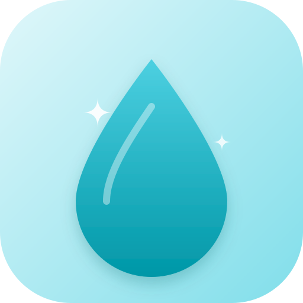
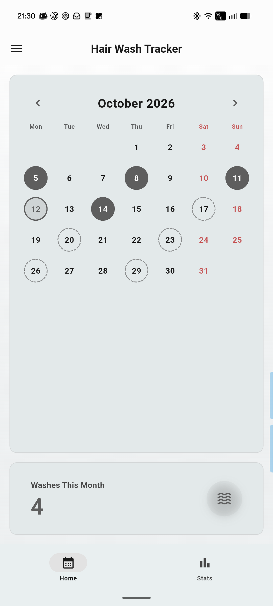
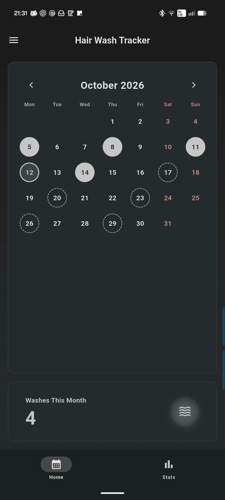
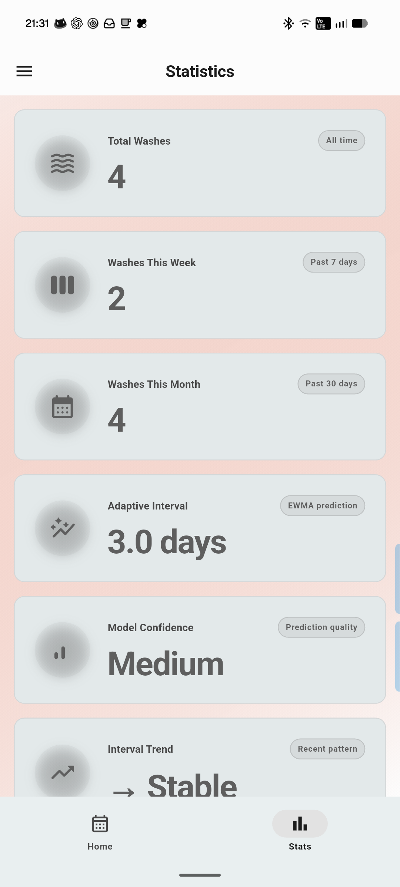
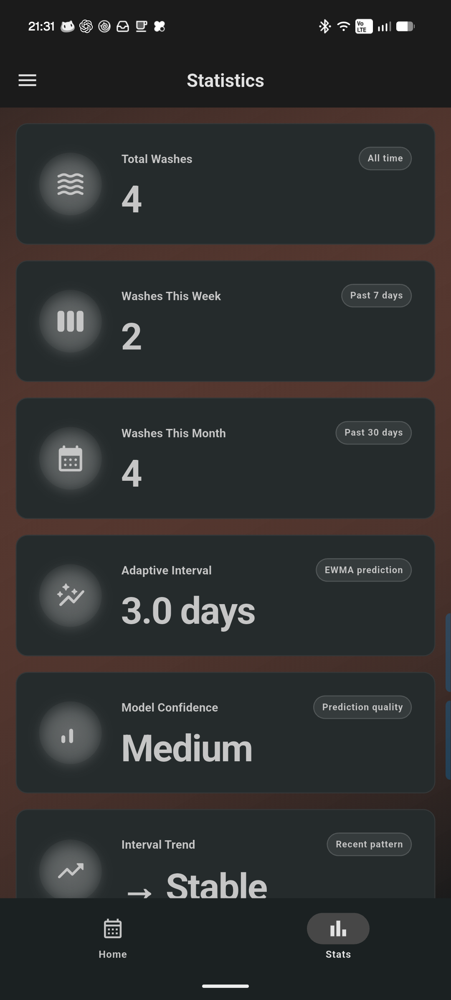

<div align="center">
  
</div>

# Hair Wash Tracker

[](LICENSE)

[English version](README.md) · [Versión en español](README_ES.md) · [Deutsche Version](README_DE.md) · [Version française](README_FR.md) · Versione italiana · [中文版](README_ZH.md)

Applicazione Flutter locale per tenere traccia della routine dei lavaggi dei
capelli. Registra i giorni di lavaggio sul calendario, consulta statistiche
settimanali e mensili e ricevi una previsione adattiva del prossimo lavaggio
consigliato. Niente account, niente cloud: i dati restano sul dispositivo.

<p align="center">
  
  &nbsp;&nbsp;
  
</p>

## Funzionalità

- Calendario mensile interattivo; tocca un giorno per registrare o rimuovere un lavaggio
- Date di lavaggio previste in base alla cronologia registrata
- Grafico a barre settimanale e contatori mensili
- Stima adattiva del prossimo lavaggio (intervallo EWMA, tendenza, affinità per giorno della settimana)
- Temi chiaro, scuro e di sistema; quattro preset (Warm Coral, Lavender
  Mist, Sage Mist, Ocean Blue) più colore dinamico Android sui dispositivi supportati
- Navigazione adattiva (barra inferiore sui telefoni, barra laterale sugli schermi grandi)
- Persistenza locale; esportazione e ripristino di un backup JSON con versione tramite il foglio di condivisione del sistema (i backup CSV della 1.0.x restano importabili)

## Statistiche

<p align="center">
  
  &nbsp;&nbsp;
  
</p>

## Stack tecnologico

- Flutter / Dart, Material 3
- `provider` per la gestione dello stato
- `table_calendar` per la vista calendario
- `shared_preferences` per l'archiviazione locale
- `dynamic_color` per il tema dinamico Android

## Per iniziare

```bash
git clone https://github.com/marodriguezd/HairWashTracker.git
cd HairWashTracker/HairWashTracker
flutter pub get
flutter run
```

Controlli di qualità:

```bash
flutter analyze
flutter test
```

## Compatibilità

- Android (minSdk 24, targetSdk 36)
- Icone di avvio adattive e monocromatiche incluse
